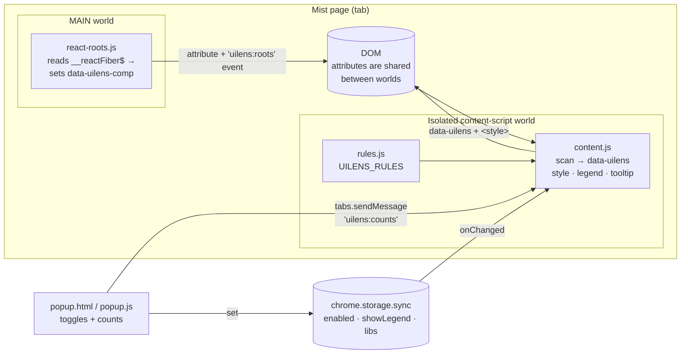

# UI Library Lens

A Chrome extension that outlines every UI component on **manage.mist.com** (and staging / local dev) with a color for the UI library that rendered it. Use it to see at a glance which parts of a page are built with Chakra UI / `ui-kit-next`, the legacy `ui-kit`, specialized libraries (Highcharts, react-select, dnd-kit, …), or in-house components with no library.

 

---

## Install

The extension isn't on the Chrome Web Store; load it unpacked:

1. Clone the repo:
   ```bash
   git clone https://github.com/albert-AIDE/UI-Library-Lens.git
   ```
2. Open `chrome://extensions` and turn on **Developer mode** (top right).
3. Click **Load unpacked** and select the cloned `UI-Library-Lens` folder.
4. Pin **UI Library Lens** from the puzzle-piece menu (optional).
5. Open or reload any page on a supported host. Colored outlines and a legend (bottom-right) appear.

**Updating:** `git pull`, then click the ↻ reload icon on the extension card in `chrome://extensions`, then reload the Mist tab.

### Supported hosts
`*.mist.com`, `*.mistsys.com`, `*.mistsys.net`, `http://localhost:*`. Edit `matches` / `host_permissions` in `manifest.json` to add more.

---

## Usage

| Control | Where | What it does |
|---|---|---|
| **Outline components** | Toolbar popup | Master on/off. Turning it off removes every outline, attribute and overlay. |
| **Show on-page legend** | Toolbar popup | Toggles the floating legend with live per-library counts. |
| Per-library checkboxes | Toolbar popup | Show or hide individual libraries. Counts are for the current tab. |
| Hover | Page | A tooltip shows the library, the React component name (when available) and the element/classes. |

Settings live in `chrome.storage.sync`, so they follow your Chrome profile and apply to every open tab immediately.

### Color legend

| Color | Library | Detected by |
|---|---|---|
| 🟪 purple | **Highcharts** | `.highcharts-container` |
| 🟧 orange | **chakra-react-select** | `input#react-select-N-input`, walked up to its container |
| 🩷 pink | **react-datepicker** | `.react-datepicker*` |
| 🟨 yellow | **GridStack** | `.grid-stack-item` |
| 🟥 red | **dnd-kit** | `[aria-roledescription="sortable" \| "draggable"]` |
| 🟦 blue | **Legacy ui-kit** (`common/src/uikit`) | `uikit-button`, `uikit-input`, `uikit-modal`, … (utility classes such as `uikit-c-*` are ignored) |
| 🟩 teal | **Chakra UI**, named components | `chakra-*` classes (`chakra-button`, `chakra-stack`, …) |
| ⬜ light teal, dashed | **Chakra primitives** (Box / Flex / Stack) | Bare Emotion `css-*` classes. **Off by default** because it's noisy. |
| ⬛ gray, dashed | **No library (in-house / plain)** | React component roots no library claimed (e.g. `MainHeader`, `MlProgressView`), plus unclaimed buttons, links, inputs, tables and ARIA controls |

---

## How it works

Production bundles are minified, so the extension can't simply read import statements. It combines two signals instead:

1. **DOM fingerprints.** Most UI libraries leave recognizable class names or ARIA attributes in the markup they render (`chakra-button`, `highcharts-container`, `react-select-3-input`, …). Each library has a CSS selector rule in `rules.js`.
2. **React component boundaries.** React 18 attaches its internal fiber to every DOM node as an expando property (`__reactFiber$…`). Walking from an element's fiber up to the nearest parent DOM fiber shows whether the element is the **first DOM node of a function or class component**, i.e. a component root. That lets the extension label in-house components that leave no class fingerprint.

### Classification

Rules run in **priority order** and an element belongs to the **first rule that claims it**. More specific libraries are listed first, so a Highcharts chart inside a Chakra `Box` is purple, not teal. The final catch-all rule (in-house) skips anything inside a library that renders its own internals (Highcharts, datepicker, react-select), so those aren't double-labeled.

Claimed elements get `data-uilens="<ruleId>"`. A single generated `<style>` element draws `outline` with `outline-offset` (not `border`), so **page layout never shifts**.

### Keeping up with a single-page app

Mist is an SPA, so both scripts use a `MutationObserver` with a debounced rescan (250–300 ms). After the main-world script marks component roots, it dispatches a `uilens:roots` DOM event and the content script rescans. Elements that disappear or stop matching are un-tagged.

---

## Architecture



### Why two worlds?

Chrome content scripts run in an **isolated world**. They share the DOM with the page but not its JavaScript objects, so React's `__reactFiber$` expandos are invisible to them. `react-roots.js` is therefore declared with `"world": "MAIN"` and publishes what it finds as plain DOM attributes, which both worlds can see. Everything that needs extension APIs (`chrome.storage`, messaging) stays in the isolated `content.js`.

### Files

| File | World / context | Responsibility |
|---|---|---|
| `manifest.json` | — | MV3 manifest: two content scripts (MAIN + isolated), popup, `storage` permission, host permissions. `all_frames: true`. |
| `react-roots.js` | Page **MAIN** world | Finds React component roots via fibers and marks them with `data-uilens-comp="<ComponentName>"`. Names come from `displayName` / `name` and may be minified in production. |
| `rules.js` | Isolated + popup | `UILENS_RULES`: ordered `{ id, label, color, selector, resolve?, dashed?, defaultOff? }`. The **only file to edit** to add or tune a library. |
| `content.js` | Isolated world | Scans the rules, tags elements with `data-uilens`, injects the stylesheet, renders the legend and hover tooltip, reacts to storage changes, answers popup count requests, and cleans up fully when disabled. |
| `popup.html` / `popup.js` | Extension popup | Master and legend toggles, per-library checkboxes, live counts from the active tab. |

### Adding a library

Add an entry to `UILENS_RULES` in `rules.js`, above any broader rule it should win over:

```js
{
  id: 'my-lib', label: 'My Library', color: '#0ea5e9',
  selector: '.my-lib-root',
  // optional: map a matched node to the element that should be outlined
  resolve: (el) => el.closest('.my-lib-wrapper') ?? el,
},
```

Reload the extension. The popup and legend pick up the new rule automatically.

---

## Privacy & permissions

- **No network requests**, analytics or remote code. Everything runs locally in the tab.
- Permissions: `storage` (your toggle settings) and host access limited to the Mist domains above.
- The page DOM is modified only by adding `data-uilens*` attributes, one `<style id="uilens-style">`, and the legend and tooltip overlays. All of it is removed when you switch the extension off.

---

## Limitations

- **Heuristic.** Detection relies on class and ARIA fingerprints, which can change across library upgrades. Chakra v3, for example, changes some class names.
- **No DOM trace:** TanStack Table (headless), react-markdown, Framer Motion, and utility libraries (Lodash, RxJS, Moment, …) can't be detected.
- **ui-kit-next wrappers** that render Chakra primitives look identical to raw Chakra.
- Component names from fibers depend on the production build. Minified names (e.g. `t`) are hidden from the tooltip.
- Cross-origin iframes get their own copy of the scripts only if their host is in `matches`.

---

## Development

No build step and no dependencies: edit the files, then hit ↻ on the extension card and reload the tab.

Quick debugging from DevTools on a Mist page:

```js
// What did the lens classify?
[...document.querySelectorAll('[data-uilens]')].map(e => [e.dataset.uilens, e.dataset.uilensComp, e]);
```
